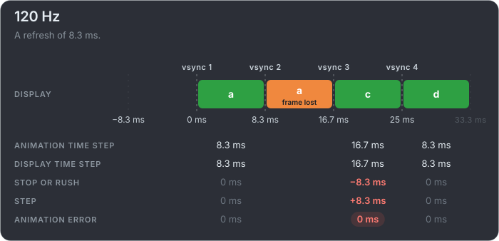

# The same lost frame on other displays

A 60 Hz monitor cannot show these clips in motion, but a report needs no such monitor: mb-framepacing reads the markers. The picture is
the same on every display, and the bill is not. A dropped frame stops the box for one refresh, so the higher the refresh rate, the
shorter the stop.

