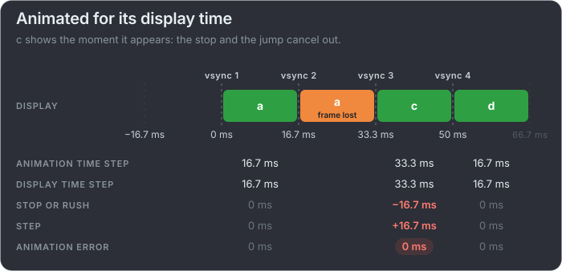
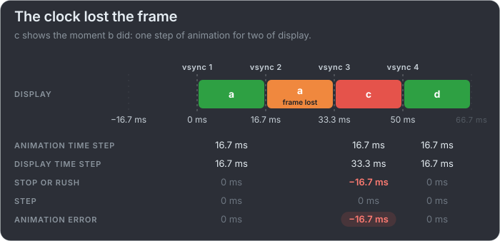
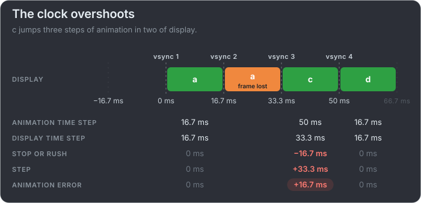

# A lost frame: the same screen, three clocks

The clips of the next slides are fixed scripts of known problems, too many in a clip for one card, so each card here shows one of
them: a few refreshes of a frame timeline.

A dropped frame looks the same on screen every time: frame a stays up for a second refresh, and the next frame to appear is c. What
the viewer sees depends on the animation. These three cards lose the same frame, b, and differ only in the moment c shows.

mb-framepacing judges each step against the target frame time, in two parts that add up to the animation error. **Stop or rush** is
the target minus the display time step: here the box stopped for a refresh. **Step** is the animation time step minus the target: how
far the box jumped when it moved again.

**Animated for its display time:** the box stops, then catches up exactly, so the sum is 0 ms. It still stuttered, so the frame counts
as an animation error, and it is a dropped frame, but it is not late.

**The clock lost the frame:** the box stops and does not catch up, so c is late, and the animation stays one frame behind from here on.

**The clock overshoots:** the box stops, then jumps past where it should be.

