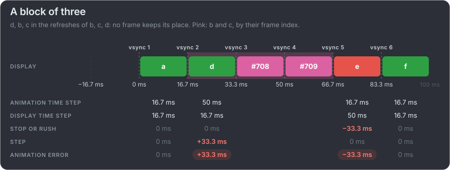
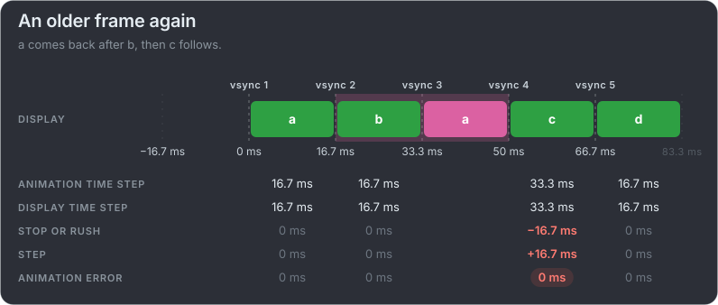
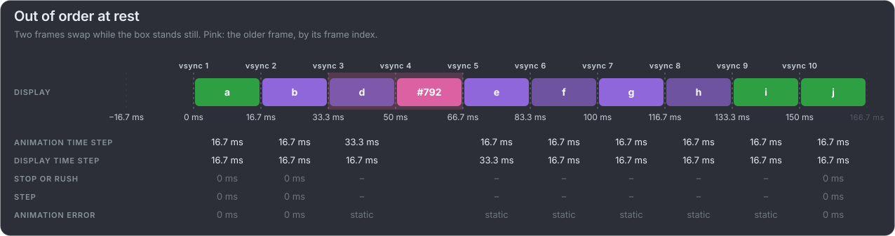

# Frames out of order, up close

A display should never show an older frame after a newer one, so mb-framepacing warns about it and marks it in pink. The newest frame
stays the one presented, so an older frame shown after it is not measured as a step of its own.

**A block of three:** three frames in the refreshes of the same three, none in its place. d comes too soon and the box jumps ahead;
b and c are never presented, and e is shown too late.

**An older frame again:** a comes back for a refresh after b. The next frame's stop and step cancel out, but the box went back.

**Out of order at rest:** two frames swap while the box stands still. Nothing moves, so nothing is judged: the violet frames are
static, and only the pink cell says the display did something it should not.

