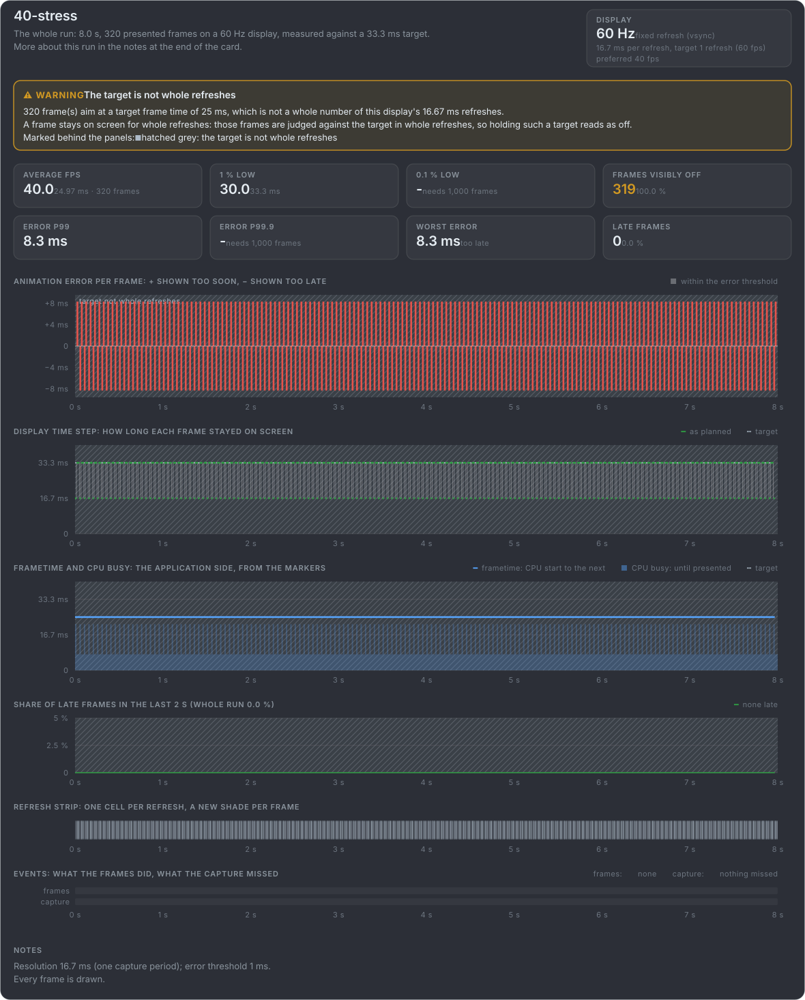
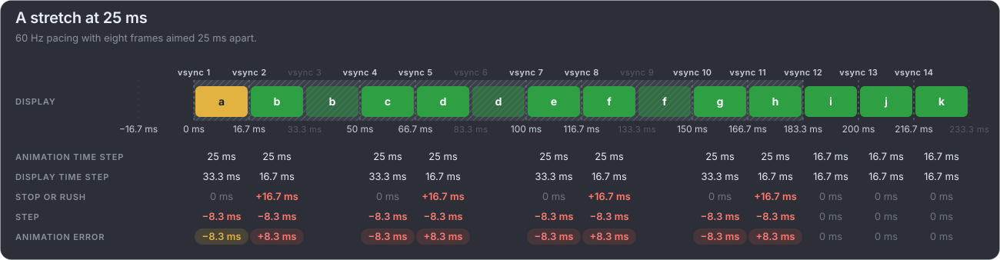

# Not a whole number of refreshes

A frame stays on screen for whole refreshes, so a target of 25 ms on a 60 Hz display (16.7 ms a refresh) cannot be held: its frames
are shown for one refresh, then two. The average is a clean 40 fps, and every step is 8.3 ms off.

**A whole capture at 25 ms:** mb-framepacing warns that the target is not whole refreshes and marks the run with a hatched grey band.
It judges such a target against the 2 whole refreshes it rounds up to, with no allowance for the cadence, so the short frames read
as off. Nothing is late: this is what such a target looks like, not a game gone wrong.

**A stretch of it:** the same target for eight frames of a game paced at 60 fps. Inside the band the error alternates, and the frames
after it are back on their refreshes.

