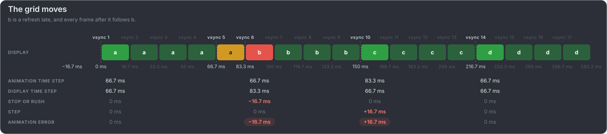
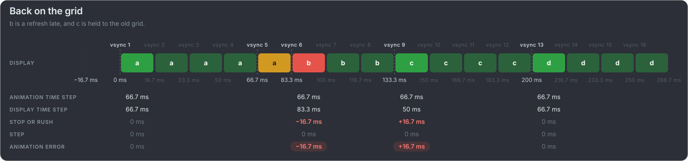
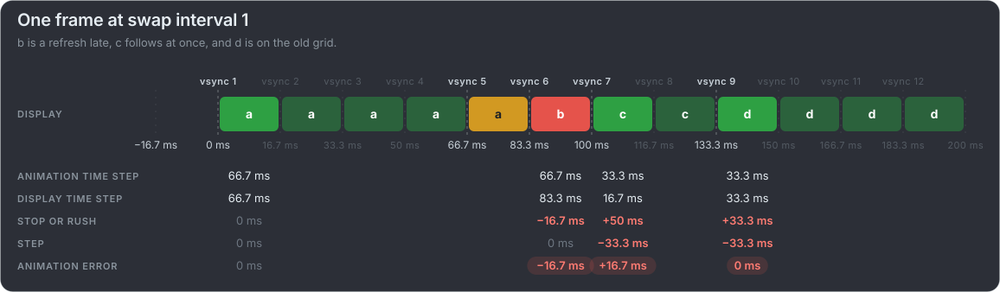

# A late frame at 15 fps: three ways back

At a target of four refreshes a pacer has room to choose. In all three cards frame b appears a refresh late, an error of −16.7 ms.
They differ in what the pacer does next.

**The grid moves:** every frame after b follows it, four refreshes apart. c catches the animation up, and from then on all is even,
one refresh later than planned.

**Back on the grid:** the next frame is held to the old grid, so b is on screen for only three refreshes. The animation never left its
plan; the display time step did, and the rush into c is the error.

**One frame at swap interval 1:** the pacer shows c as soon as it can, then holds d to the old grid. It costs one error more: c is
shown too soon, and d's rush and step cancel out but still count.

